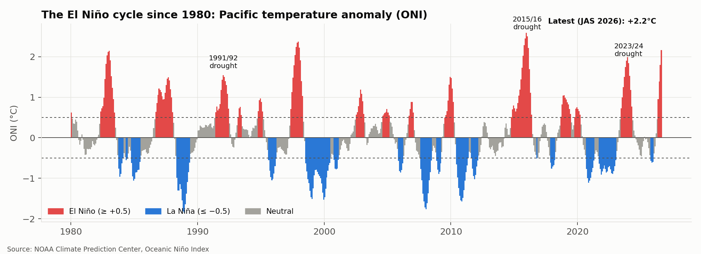
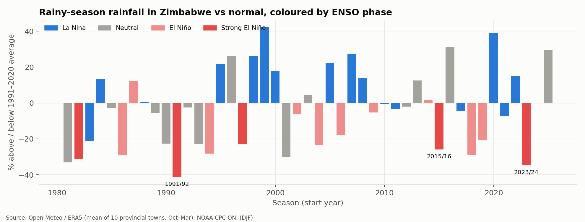
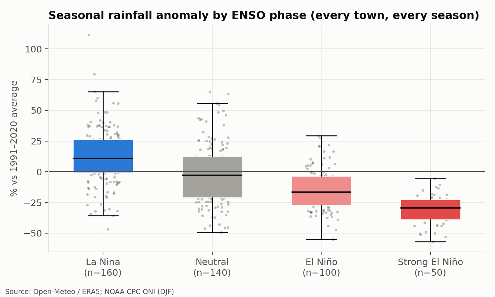
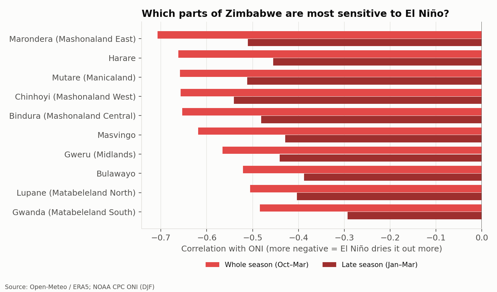
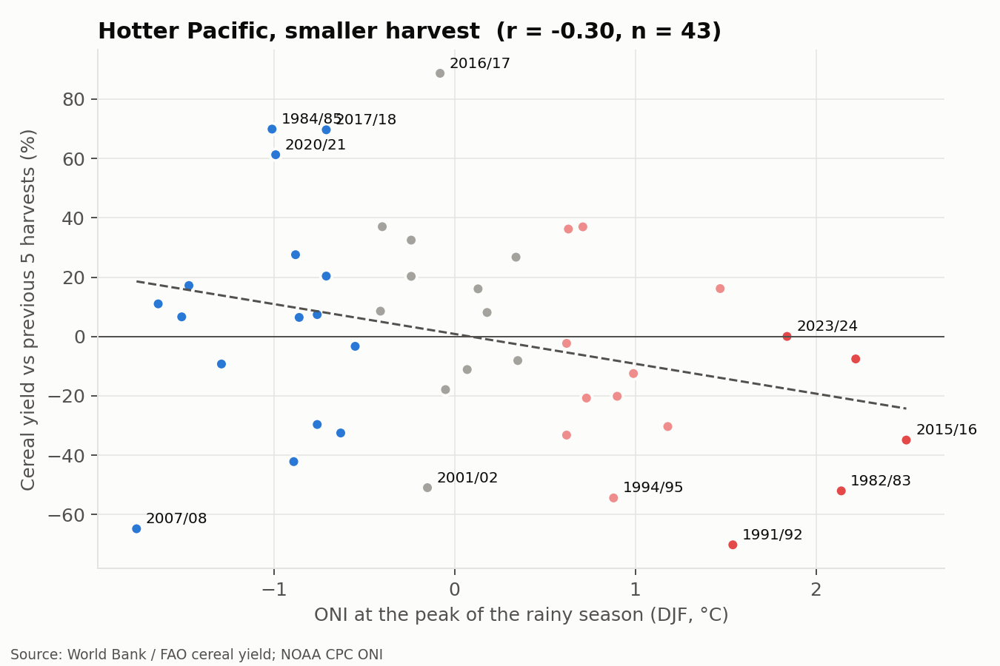
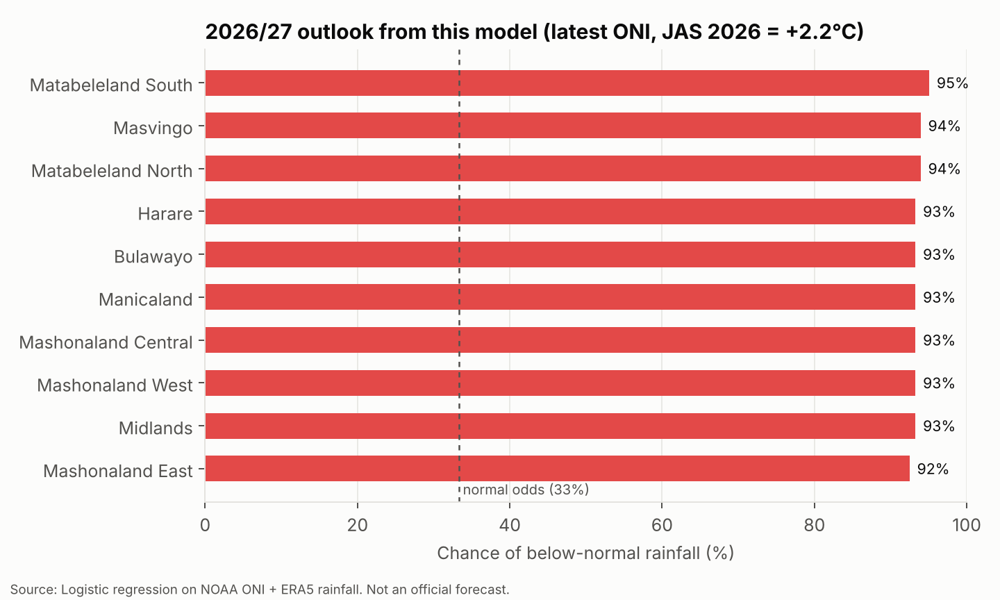

# El Niño and Drought Risk in Zimbabwe

**🔗 Live dashboard: https://zimbabwe-elnino.streamlit.app/

**Can last century's climate record tell us which provinces are most at risk in the 2026/27 El Niño season?**

## The problem

Zimbabwe's Meteorological Services Department puts the chance of El Niño during the 2026/27 rainy season at 88–94%, with a 65% chance of below-normal rainfall. The last strong El Niño (2023/24) brought the worst drought in about 40 years, and the 2015/16 event cut maize harvests across the region.

National forecasts say "drier than normal" for the whole country. But farmers, NGOs and local planners need sharper answers:

1. **How much** drier do El Niño seasons actually get in Zimbabwe?
2. **Where**: which provinces are hit hardest?
3. **When**: is it the early rains (Oct–Dec) or the late season (Jan–Mar) that fails?
4. **So what**: how much does the harvest fall?

## Why it matters

Turning a vague national warning into province-level risk helps decide where food aid, drought-tolerant seed, water trucking and livestock support should go first, before the crisis rather than after it.

## Data (all free and open)

| Data | Source | Used for |
|---|---|---|
| Oceanic Niño Index (ONI), 1950–present | [NOAA Climate Prediction Center](https://www.cpc.ncep.noaa.gov/products/analysis_monitoring/ensostuff/ONI_v5.php) | Measuring El Niño / La Niña strength |
| Daily rainfall for 10 provincial towns, 1981–present | [Open-Meteo historical API](https://open-meteo.com/en/docs/historical-weather-api) (ERA5 reanalysis) | Seasonal rainfall and anomalies |
| Cereal yield and production, Zimbabwe | [World Bank Open Data](https://data.worldbank.org/indicator/AG.YLD.CREL.KG?locations=ZW) (from FAO) | Harvest impact |

## Method

1. **Seasons.** The rainy season is October–March, labelled by start year (2015 = 2015/16). Only complete seasons are used.
2. **Rainfall anomalies.** Each season is compared with the 1991–2020 average at that town, as a percentage and as terciles (below normal = driest third of seasons).
3. **ENSO phase.** Each season is classed by its December–February ONI: La Niña (≤ −0.5), Neutral, El Niño (≥ +0.5), Strong El Niño (≥ +1.5). This is a simplification of NOAA's official event definition.
4. **Analysis.** Rainfall by phase, statistical test of El Niño vs neutral seasons, correlation with ONI for each town (whole season vs Jan–Mar), and cereal yield against the five previous harvests.
5. **Baseline model.** Logistic regression predicting the chance of below-normal rainfall at each town from the August–October ONI, which is published in early November, before the main rains. Scored with leave-one-season-out cross-validation against a no-skill 33% forecast (Brier skill score, ROC AUC).

## Results

Data: 45 complete rainy seasons (1981/82 to 2025/26) at 10 provincial towns.

### 1. Strong El Niño years almost always mean a dry season

| ENSO phase | Town-seasons | Rainfall vs normal | In the driest third |
|---|---|---|---|
| La Niña | 160 | **+12.7%** | 10% |
| Neutral | 140 | −1.3% | 34% |
| El Niño | 100 | **−14.6%** | 53% |
| Strong El Niño | 50 | **−31.3%** | **94%** |

In strong El Niño seasons, 94% of town-seasons fell in the driest third, against 33% expected by chance. El Niño seasons were significantly drier than neutral ones (Mann-Whitney U, p < 0.001). Three of the five driest seasons on record were strong El Niño years: 1991/92 (−41%), 2023/24 (−35%) and 1982/83 (−31%).





### 2. The north and east are the most El Niño-sensitive

Marondera (Mashonaland East, r = −0.71), Harare, Mutare and Chinhoyi (all r = −0.66) track the El Niño index most closely. The south is drier on average but its rainfall follows El Niño less tightly, likely because other drivers matter more there.

Strong El Niño seasons cut rainfall in both halves of the season on average (−29% Oct–Dec, −33% Jan–Mar), but events differ: 2015/16 failed early (−48% Oct–Dec), while 1991/92 and 2023/24 collapsed late (−54% and −51% Jan–Mar). Late failures hit crops at flowering, which is why they hurt harvests most.



### 3. Harvests follow, with a caveat about the data

Cereal yield fell by about 10% for every +1 °C on the ONI (r = −0.30, p = 0.05, 43 harvests). The biggest losses followed El Niño droughts: 1992 (−70% against the previous five harvests), 1995 (−54%), 1983 (−52%) and 2016 (−35%).

Data-quality note: the World Bank/FAO yield for 2024 is identical to 2023 (1,070 kg/ha), which suggests an estimate rather than a measured harvest, so the 2023/24 drought's impact is likely understated here.



### 4. Baseline model and the 2026/27 outlook

A logistic regression using only the El Niño index (available before the rains start) beats a no-skill forecast in leave-one-season-out testing:

| Metric | Model | No skill |
|---|---|---|
| Brier skill score | **+0.20** | 0 |
| ROC AUC | **0.78** | 0.50 |

It is also well calibrated: when it predicted above 45%, the season was below normal 66% of the time (mean prediction 67%).

With the latest ONI (July–September 2026 = **+2.16 °C**, the strongest since 2015/16) the model gives every province a **92–95% chance** of below-normal rainfall in 2026/27.



**Why this is more confident than the official outlook (65%).** The history behind it is thin: only three seasons (1997/98, 2015/16, 2023/24) started with an ONI this high, and in each, 80–100% of towns were below normal. A one-variable model extrapolates that small sample. The Meteorological Services Department combines many more drivers (Indian Ocean temperatures, other dynamical models), so its lower figure reflects real uncertainty this baseline cannot see. The direction agrees; the confidence should not be taken at face value.

## How to run

Requires Python 3.10+.

```bash
git clone https://github.com/<your-username>/elnino-zimbabwe.git
cd elnino-zimbabwe
python -m venv .venv
source .venv/bin/activate        # Windows: .venv\Scripts\activate
pip install -r requirements.txt
python run_all.py                # downloads data, builds tables, makes figures and reports
streamlit run app.py             # opens the interactive dashboard in your browser
```

Or step by step: `python -m src.download_data`, `python -m src.build_features`, `python -m src.analysis`, `python -m src.model`.

## Project structure

```
├── run_all.py               # whole pipeline
├── app.py                   # interactive Streamlit dashboard
├── src/
│   ├── config.py            # towns, season definition, thresholds, colours
│   ├── download_data.py     # NOAA, Open-Meteo, World Bank downloads
│   ├── build_features.py    # seasonal rainfall, anomalies, ENSO phase, harvests
│   ├── analysis.py          # figures 1–5 + reports/summary.md
│   ├── model.py             # baseline model, figure 6 + reports/model_report.md
│   └── dashboard_data.py    # data and model helpers for the dashboard
├── data/raw/                # downloads (not committed)
├── data/processed/          # tidy tables
├── figures/
└── reports/
```

## Limitations

* Rainfall is from ERA5 reanalysis at one point per province, not rain gauges. Reanalysis can miss local storms.
* About 45 seasons and roughly a dozen El Niño events: a small sample, so treat correlations with care.
* ENSO is one driver among several (Indian Ocean Dipole, local conditions). The model is a baseline to beat, **not an official forecast**. For decisions, use the Meteorological Services Department and SARCOF outlooks.
* Cereal yield is national and also moved by policy, inputs and land use, not just rain.

## Roadmap

- [ ] **Phase 2:** district-level rainfall from CHIRPS (5 km satellite rainfall) and vegetation health (NDVI) via Google Earth Engine
- [ ] Add the Indian Ocean Dipole and sea-surface temperature features; compare logistic regression, random forest and gradient boosting
- [x] Interactive dashboard (Streamlit): outlook map with what-if slider, history, province explorer
- [ ] Track the 2026/27 season month by month as it unfolds

## Author

Your Name · [LinkedIn](#) · [GitHub](#)
